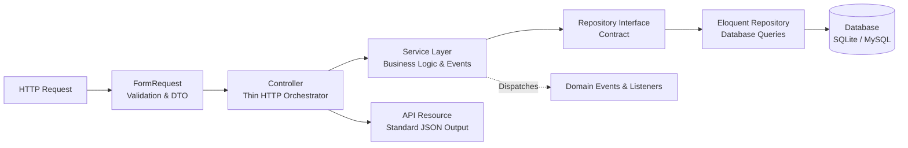

# Collabspace


> **Collabspace** is a high-performance remote-work collaboration platform built for the **Huma Volve competition**. Designed for distributed product and engineering teams, Collabspace unifies multi-tenant workspaces, team management, project boards, private file versioning, asynchronous chat threads, scheduled video meetings, daily asynchronous standups, time tracking, and analytics dashboards into an intuitive, secure REST API.

---

## Architecture Overview

Collabspace follows a strict **Layered Architecture** adhering to clean code standards:
```
Route → FormRequest → Controller → Service → Repository Interface → Eloquent Model
```



### Layer Responsibilities
- **FormRequests & DTOs**: Strictly validates input before execution; encapsulates typed data transfer objects (no loose associative arrays).
- **Controllers**: Thin HTTP orchestrators. Never contain business logic or raw Eloquent queries. Always return standardized JSON (`ApiResponse`).
- **Service Layer**: Implements business rules, transactions, permission checks, and domain events. Services **never** interact with Eloquent builders directly (`::query()`, `->where()`) and **never** return API Resources.
- **Repository Interface & Eloquent Repositories**: All persistence and query operations reside exclusively behind interface contracts. Queries enforce tenant scoping and project visibility rules.
- **Models & Scopes**: Eloquent models with typed properties and multi-tenant scoping via `BelongsToWorkspace`.

---

## Folder Structure

```text
app/
├── Data/                 # Strongly-typed Data Transfer Objects (DTOs)
├── Enums/                # Strict domain enums (TaskStatus, MeetingStatus, etc.)
├── Events/               # Domain event dispatches (TaskCreated, MeetingCreated, etc.)
├── Http/
│   ├── Controllers/Api/V1/ # Thin REST API Controllers
│   ├── Middleware/       # Workspace tenant validation, ForceJson, Throttling
│   ├── Requests/         # Strongly-typed FormRequests
│   └── Resources/        # Consistent API Resource transformers
├── Listeners/            # Queued and sync activity & notification listeners
├── Models/               # Eloquent Models & Scopes (BelongsToWorkspace)
├── Policies/             # Authorization policies (Workspace, Project, Task, Channel)
├── Repositories/
│   ├── Contracts/        # Repository Interfaces
│   └── Eloquent/         # Eloquent persistence implementations
├── Services/             # Business Logic & Orchestration
│   └── Storage/          # Private disk file storage abstraction
└── Support/              # CurrentWorkspace context, ApiResponse helpers
```

---

## Tech Stack

- **PHP 8.5 / 8.4** (Strict typing, read-only properties, constructor promotion)
- **Laravel 13.x**
- **Laravel Sanctum** (Token-based API authentication)
- **Laravel Socialite** (Google OAuth identity federation)
- **SQLite / MySQL** (Compatible with driver-independent queries)
- **Scramble** (Automated OpenAPI 3.1 documentation)
- **Pest v5** (Behavior-driven unit and feature test suite)
- **Laravel Pint** (PSR-12 and Laravel code style enforcement)
- **Larastan / PHPStan** (Level 5 static analysis with 0 errors)

---

## Multi-Tenancy Design

Multi-tenancy in Collabspace is achieved through workspace isolation:
1. **Workspace Scope**: All workspace-specific models leverage the `BelongsToWorkspace` trait, automatically applying a `WorkspaceScope`.
2. **`X-Workspace-Id` Header**: Every authenticated API request requires the `X-Workspace-Id` header identifying the active tenant.
3. **Middleware Verification**: The `SetCurrentWorkspace` middleware validates that the authenticated user is an active member of the target workspace before granting access.
4. **Project Visibility Hierarchy**:
   - `admin` and `manager` roles see all projects in the workspace.
   - `member` roles see only projects they belong to directly or via an attached team.
   - Tasks, files, meetings, and team statuses inherit this visibility rule automatically.

---

## Key Design Decisions

- **Computed Overdue & Metrics**: Overdue statuses and task progress percentages are computed dynamically from due dates and status histories rather than stored redundantly.
- **Private File Storage & Versioning**: Files are stored on a private disk via the `FileStorage` contract. Uploads track checksums, MIME types, versions, and notes.
- **Decoupled Activity & Notifications**: User actions dispatch domain events. Decoupled listeners log activity streams and dispatch user notifications according to configurable notification preferences.
- **Asynchronous Reports**: Heavy report generation exports CSV files in the background via queued jobs.
- **Real-Time Ready Architecture**: Chat channels (public, project, team, direct) and message threads are built with database persistence and WebSocket broadcasting primitives ready for Laravel Reverb.

---

## Features by Module

1. **Authentication & Profile**: Email/password, Google OAuth, remember-me token lifetimes, avatar upload, and user preferences.
2. **Workspaces & Teams**: Multi-tenant workspaces with role assignments (`admin`, `manager`, `member`) and functional teams.
3. **Projects & Kanban Board**: Priority and status tracking, custom sort positions, column reordering, and team attachments.
4. **Task Collaboration & Comments**: Assignees, reviewers, progress tracking, and polymorphic comments on tasks and meetings.
5. **Private File Manager**: Chunked file upload, category grouping, and multi-version history with download streaming.
6. **Time Tracking**: Live timers (one active timer enforced per user), manual logging, and user work statistics.
7. **Interactive Dashboard**: Monthly completion rates, weekly/yearly activity bucketing, deadline lists, and upcoming meetings.
8. **Chat & Message Threads**: Public channels, project/team channels, direct messaging with unique keys, and nested replies.
9. **Meetings & Standups**: Weekly meeting schedules, RSVP responses, Google Meet/Zoom URLs, meeting notes, and daily standup status reports with blockers.
10. **Reports & Exports**: Task completion rates, team activity summaries, and queued CSV export generation.

---

## Getting Started in 5 Steps

### 1. Clone & Install Dependencies
```bash
git clone https://github.com/collabspace/collabspace.git
cd collabspace
composer install
```

### 2. Configure Environment
```bash
cp .env.example .env
php artisan key:generate
```

### 3. Run Migrations & Demo Seeder
```bash
php artisan migrate --seed
```

### 4. Start the Application Server
```bash
php artisan serve
```
The API is now running at `http://localhost:8000`.

### 5. Background Workers & Scheduler (Optional for queue/cron)
```bash
# In separate terminal windows:
php artisan queue:work
php artisan schedule:work
```

---

## Demo Credentials

The database seeder creates a pre-populated workspace with realistic data:

| Role | Email | Password | Active Workspace ID |
|---|---|---|---|
| **Admin** | `admin@collabspace.test` | `password` | `1` |
| **Manager** | `manager@collabspace.test` | `password` | `1` |
| **Member** | `khalid@collabspace.test` | `password` | `1` |
| **Member** | `tariq@collabspace.test` | `password` | `1` |
| **Member** | `leila@collabspace.test` | `password` | `1` |
| **Member** | `maya@collabspace.test` | `password` | `1` |
| **Member** | `zara@collabspace.test` | `password` | `1` |

---

## Quick API Walkthrough (cURL)

### 1. Health Check
```bash
curl -X GET http://localhost:8000/api/v1/health
```

### 2. Authenticate
```bash
curl -X POST http://localhost:8000/api/v1/auth/login \
  -H "Content-Type: application/json" \
  -d '{"email":"admin@collabspace.test","password":"password"}'
```
*Save the returned `token` for subsequent requests.*

### 3. Fetch Dashboard Stats
```bash
curl -X GET http://localhost:8000/api/v1/dashboard/stats \
  -H "Authorization: Bearer <TOKEN>" \
  -H "X-Workspace-Id: 1"
```

### 4. List Projects
```bash
curl -X GET http://localhost:8000/api/v1/projects \
  -H "Authorization: Bearer <TOKEN>" \
  -H "X-Workspace-Id: 1"
```

### 5. Create a New Task
```bash
curl -X POST http://localhost:8000/api/v1/tasks \
  -H "Authorization: Bearer <TOKEN>" \
  -H "X-Workspace-Id: 1" \
  -H "Content-Type: application/json" \
  -d '{
    "project_id": 1,
    "title": "Build WebSocket notification channel",
    "priority": "high",
    "due_date": "2026-12-01"
  }'
```

### 6. Move Task on Kanban Board
```bash
curl -X POST http://localhost:8000/api/v1/tasks/1/move \
  -H "Authorization: Bearer <TOKEN>" \
  -H "X-Workspace-Id: 1" \
  -H "Content-Type: application/json" \
  -d '{
    "status": "in_progress",
    "position": 1
  }'
```

---

## Interactive API Documentation

Collabspace provides full OpenAPI 3.1 documentation:
- **Interactive Web UI**: [http://localhost:8000/docs/api](http://localhost:8000/docs/api)
- **OpenAPI 3.1 JSON Specification**: [docs/openapi.json](docs/openapi.json) (or `http://localhost:8000/docs/api.json`)
- **Regenerate Spec**:
  ```bash
  php artisan scramble:export
  ```

---

## Code Quality & Testing

Run all quality checks using composer shortcuts:

```bash
# Run unit & feature tests with Pest
composer test

# Run code style checks with Pint
composer lint

# Run static type analysis with Larastan (0 errors)
composer analyse
```

---

## Roadmap & Production Enhancements

- **Real-Time WebSockets**: Live broadcast updates on chat, task board drags, and notification bells via Laravel Reverb.
- **CollabAI Copilot**: Native LLM agent integration for automatic meeting summaries, task breakdown generation, and blocker triage.
- **PDF Report Generation**: Server-side PDF template rendering for executive progress exports.
- **Calendar Synchronization**: Bidirectional iCal / Google Calendar sync for scheduled meetings.

---

## Credits

- **Backend Architecture & Engineering**: Collabspace Core Team
- **UI/UX Design**: Collabspace Design Team C (Huma Volve Competition)
